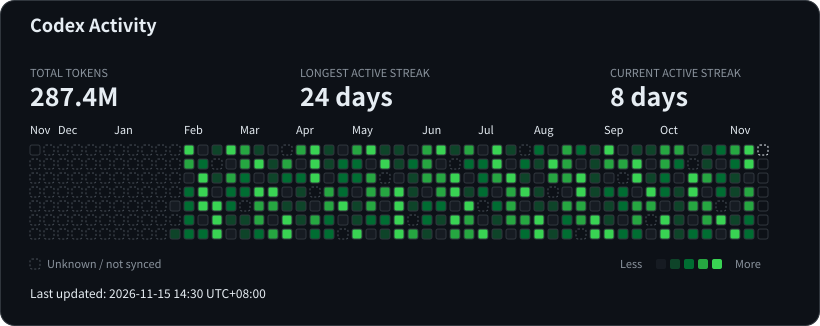

# Codex Activity

[简体中文（默认）](./README.md) | **English**

Display daily Codex token activity on your GitHub Profile. Sync manually from one computer; GitHub Actions rolls the heatmap forward daily. No runtime dependencies.



The preview uses fixed synthetic data, with no real account information. A [light preview](./examples/github-light.svg) is also available.

## Quick start

You need Windows, Node.js **24.10+**, Git, and a signed-in Codex runtime supporting `account/usage/read`. Your Profile repository must already exist with at least one commit and a default branch. GitHub CLI and `npm install` are unnecessary.

1. Clone the tool repository or extract a source package with release metadata. In the tool directory, run:

   ```powershell
   Copy-Item .env.example .env
   ```

2. Edit `.env` locally and fill in the required settings:

   ```dotenv
   GITHUB_TOKEN=your-fine-grained-token
   GITHUB_REPOSITORY=your-name/your-name
   ```

   Create a GitHub **Fine-grained personal access token**: select your account as Resource owner, select only the target Profile repository, grant **Contents: Read and write**, and set an expiration. Metadata read access is automatic; Workflows permission is unnecessary. Do not commit `.env`.

3. Check configuration and generate integration files:

   ```powershell
   npm run setup
   ```

4. Follow `generated/SETUP.en.md`: place `codex-activity.yml` in the **Profile repository** under `.github/workflows/`, add the image reference from `README-snippet.en.md` to its README, then commit those files.

5. Return to the local tool directory and upload statistics:

   ```powershell
   npm run sync
   ```

No initial statistics JSON, Actions Secrets, or local clone of the Profile repository is needed. Wait for Profile Actions to generate the chart after upload. Run `npm run status` to check status.

`setup` anonymously checks that the pinned revision is published in the public tool repository. Unpublished revisions cannot generate integration files. Maintainers should read the [release procedure](./docs/development.en.md#release-procedure) first.

## Documentation

Chinese is the default language. Matching `*.en.md` files contain English versions.

| Document | Contents | 简体中文 |
| --- | --- | --- |
| [Usage](./docs/usage.en.md) | Configuration, commands, data semantics, time, recovery | [使用指南](./docs/usage.md) |
| [Privacy and credentials](./docs/security.en.md) | Public fields, token scope, local cache | [隐私与凭据](./docs/security.md) |
| [Development and releases](./docs/development.en.md) | Layout, validation, cleanup rules, pinned releases | [开发与发布](./docs/development.md) |

## Development checks

```powershell
npm test
npm run render:example
npm pack --dry-run
```

Tests and previews use synthetic data without real credentials. See the guide above for development and release instructions.

[MIT License](./LICENSE)
