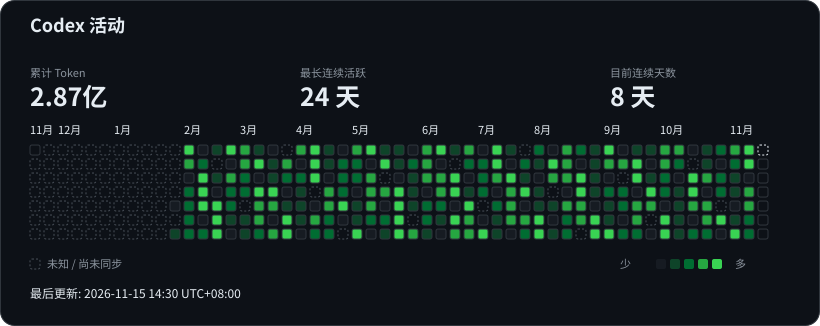

# Codex Activity

**简体中文（默认）** | [English](./README.en.md)

把 Codex 每日 Token 活动展示在 GitHub Profile 上。单机手动同步，GitHub Actions 每天自动滚动热力图；零运行时依赖。



上图使用固定合成数据，不包含真实账号信息。另有[浅色示例](./examples/github-light.zh-CN.svg)。图片默认英文，可在 `.env` 设置 `ACTIVITY_LANGUAGE=zh-CN` 切换中文。

## 快速开始

需要 Windows、Node.js **24.10+**、Git，以及已登录且支持 `account/usage/read` 的 Codex 运行时。目标 Profile 仓库须已存在，并至少有一次提交和默认分支。无需 GitHub CLI，也无需 `npm install`。

1. 克隆工具仓库或解压带版本元数据的源码包，在工具目录执行：

   ```powershell
   Copy-Item .env.example .env
   ```

2. 在本机编辑 `.env`，填写两个必填项：

   ```dotenv
   GITHUB_TOKEN=填写你的细粒度Token
   GITHUB_REPOSITORY=你的用户名/你的用户名
   ```

   创建 GitHub **Fine-grained personal access token**：Resource owner 选择自己的账户，仅选择目标 Profile 仓库，授予 **Contents: Read and write** 并设置有效期。Metadata 读取权限自动提供，无需 Workflows 权限。不要提交 `.env`。

   可选：设置 `ACTIVITY_THEME=github-light` 使用浅色主题、`ACTIVITY_LANGUAGE=zh-CN` 使用中文图片；默认深色、英文。接入新版工作流后，修改这些选项并运行 `npm run sync` 即可生效。

3. 检查配置并生成接入材料：

   ```powershell
   npm run setup
   ```

4. 按 `generated/SETUP.md` 操作：把 `codex-activity.yml` 放入 **Profile 仓库**的 `.github/workflows/`，将 `README-snippet.md` 中的图片引用加入 Profile README，然后提交这些文件。

5. 回到本机工具目录上传统计：

   ```powershell
   npm run sync
   ```

无需提前创建统计 JSON、配置 Actions Secrets 或克隆 Profile 仓库到本机。上传后等待 Profile Actions 生成图表；可以用 `npm run status` 检查状态。

`setup` 会匿名检查固定版本是否已发布到公开工具仓库；未发布的版本不能生成接入材料。维护者请先阅读[发布流程](./docs/development.md#发布流程)。

## 文档导航

所有文档默认使用中文，同目录的 `*.en.md` 提供对应英文版本。

| 文档 | 内容 | English |
| --- | --- | --- |
| [使用指南](./docs/usage.md) | 配置、命令、数据语义、时间与故障恢复 | [Usage](./docs/usage.en.md) |
| [隐私与凭据](./docs/security.md) | 公开字段、Token 边界、本地缓存 | [Privacy and credentials](./docs/security.en.md) |
| [开发与发布](./docs/development.md) | 项目结构、验证、文件清理规则、固定版本发布 | [Development and releases](./docs/development.en.md) |

## 开发验证

```powershell
npm test
npm run render:example
npm pack --dry-run
```

测试和示例仅使用合成数据，不需要真实凭据。开发与发布步骤见上方指南。

[MIT License](./LICENSE)
