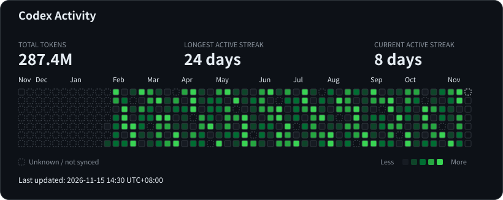

# Codex Activity

把 Codex 每日 Token 活动展示在 GitHub Profile 上。单机、手动同步、零运行时依赖；GitHub 每天自动滚动热力图。



上图是固定的合成示例，不包含真实账号数据。也提供 [浅色示例](./examples/github-light.svg)。

## 快速接入

需要 Windows、Node.js **24.10+**、Git，以及已登录且支持 `account/usage/read` 的 Codex 运行时。无需 GitHub CLI。首次版本发布后，从公开工具仓库克隆代码或下载包含版本元数据的源码包。

在工具目录中：

```powershell
Copy-Item .env.example .env
```

只需在本机编辑 `.env` 的两个必填项：

```dotenv
GITHUB_TOKEN=填写你的细粒度Token
GITHUB_REPOSITORY=你的用户名/你的用户名
```

在 GitHub 创建 **Fine-grained personal access token**，Resource owner 选择自己的账户，Repository access 只选目标 Profile 仓库，授予 **Contents: Read and write**，设置有效期。Metadata 读取权限由 GitHub 自动提供。不要选择全部仓库，不需要 Workflows 权限。

然后执行：

```powershell
npm run setup
```

setup 会发现默认分支和 Codex，检查账户用量及仓库访问，并在 `generated/` 中生成接入材料：

1. 将生成的 `codex-activity.yml` 添加到 **Profile 仓库**的 `.github/workflows/`。
2. 将 `README-snippet.md` 中的一行图片引用加入 Profile README。
3. 提交以上接入文件，回到本机工具目录执行：

```powershell
npm run sync
```

无需提前创建统计 JSON，无需配置 GitHub Actions Secrets，无需把 Profile 仓库克隆到本机。工具本身无需 `npm install`；npm scripts 只使用 Node 内置模块。

**首次发布要求**：生成入口会固定工具的完整提交 SHA。该提交必须先推送到公开工具仓库，远程工作流才能调用。当前上游仓库名是 `Lancasteerr/codex-activity`；维护者若使用其他名称，应同时修改 package.json 与可复用工作流的工具 checkout 仓库，再准备发布。

## 配置与命令

| 配置 | 必填 | 说明 |
|---|---|---|
| `GITHUB_TOKEN` | 是 | 仅目标仓库 Contents 读写的细粒度 Token |
| `GITHUB_REPOSITORY` | 是 | 已存在的 `owner/repo`，使用默认分支 |
| `CODEX_BIN` | 否 | Codex 可执行文件路径；留空自动发现 |
| `TIMEZONE` | 否 | IANA 显示时区；留空读取本机，如 `Asia/Singapore` |

只读取当前目录 `.env`，不搜索父目录、不静默使用环境中的其他 Token。可显式指定配置文件：

```powershell
npm run status
npm run sync -- --env-file C:\private\codex-activity.env
```

- `setup`：检查配置并生成接入材料，不修改远程仓库或 `.env`。
- `status`：检查采集与 GitHub 读取权限，显示最近上传时间；不写远程内容。首次 sync 才能最终验证写入权限。
- `sync`：读取统计、合并已观测历史、比较内容，有变化才上传。

成功上传和无变化均返回退出码 0，失败返回 1。上传成功仅表示 JSON 已提交，SVG 仍需等待 Actions 完成。暂不提供本地定时任务或多设备/多账户合并。

## 数据、时间与每日滚动

Profile 中只保存一份 `data/codex/usage.json` 和一张 `assets/codex-activity.svg`。工具独占维护 JSON，Actions 只写 SVG。

- 保存接口实际返回的所有历史；不假定固定返回多少天。
- 同日用新值覆盖，不累加；接口窗口缩短不删除已保存日期。
- 明确返回的 0 是零用量；缺失日期显示为 unknown；每日桶为 null 或采集失败时不覆盖远程文件。
- 汇总值允许 null，并显示 Unavailable。累计 Token 使用官方汇总，不通过有限的每日记录求和推算。
- 只公开协议版本、来源标记、累计 Token、连续天数和每日 Token；不包含账户信息或原始 RPC。
- `Last updated` 是最近修改统计 JSON 的 Git 提交时间，即最近实际上传时间。无变化时不上传，也不改变这个时间。不要手工编辑 JSON，否则那次编辑也会成为新的数据更新时间。
- 每日按显示时区约 00:17 重绘最近 52 周，更新当天标记；本机可以关机。模板使用 GitHub 的 IANA timezone 定时设置；新加坡 00:17 等价于 UTC 前一天 16:17。
- 定时重绘不查询 Codex，不改变 Last updated。未上传的新日期保持 unknown，摘要明确标示为上次同步时的值。
- 官方日期桶原样保留；显示时区不用于重新拆分每日统计。

主题默认 `github-dark`。需要浅色时，把 Profile 工作流入口中的 `theme` 改为 `github-light`；修改入口会触发重绘。工作流及渲染器均固定不可变提交，升级时重新运行新版 setup 并替换 Profile 的入口文件。

## 授权信息如何处理

`.env` 是本机明文配置，请只放在自己的电脑上。它被 Git 忽略，不进入 npm 发布包或生成的接入材料。工具不创建包含真实 Token 的 `.env`，也不把 Token 复制到缓存、进程全局环境或 Codex 子进程。

GitHub 上传使用原生 fetch，目标固定为官方 API，拒绝 HTTP 重定向。Codex 统计使用运行时自己的登录状态；工具不读取、复制或上传 `auth.json`，不创建对话或运行模型。

数据提交使用目标仓库拥有者的 GitHub noreply 邮箱署名，避免把账户的私人主邮箱带入公开提交元数据。署名不替代 Token 鉴权。

日志不输出原始响应、请求头、配置对象或上游异常。公开数据重新按字段白名单构造，原始账户、邮箱、Cookie、API key 和令牌字段不会被复制。Actions 只使用 GitHub 自动提供的临时 `GITHUB_TOKEN`，没有本机 Token 或 Codex 登录态。

细粒度 Token 的 Contents 权限覆盖所选仓库，不是只允许修改统计文件。不要把 `.env` 加进 Profile，不要使用 `git add -f` 绕过忽略规则，不要把 Token 发进聊天或 issue。更换账户时请重新建立独立的历史，V1 不支持混合账户。

## 失败与恢复

| 情况 | 处理方式 |
|---|---|
| 找不到 Codex | 在 `.env` 的 CODEX_BIN 中指定兼容的 codex.exe |
| 无法读取 Codex 登录态/统计 | 回原应用检查登录或升级运行时；不手工复制令牌 |
| Token 无效或过期 | 本机更新 `.env` 后重试，不会上传旧授权信息 |
| 403/限流/分支规则拒绝 | 检查目标仓库、Contents 权限、仓库策略，或等限流恢复 |
| 仓库为空或不存在 | 先创建 Profile 仓库并添加 README，建立默认分支 |
| 暂时网络错误 | 自动少量重试；清洗后的待上传统计缓存在用户数据目录，下次 sync 自动合并 |
| 上传时发生 SHA 冲突 | 重新读取并合并后重试；不强推 |
| JSON 已上传但图表失败 | 到 Profile Actions 手动运行 Codex Activity，或等待下次每日任务 |
| 工具 checkout 找不到 SHA | 确认引用提交已推送到公开工具仓库，重新 setup 更新入口 |
| 每日任务延迟/停用 | GitHub 调度不保证准点，公开仓库长期无活动可能停用；到 Actions 重新启用或手动运行 |

Windows 缓存位置为 `%LOCALAPPDATA%\codex-activity\<仓库散列>\`，仅包含清洗后的统计及进程锁，没有 Token。第一次成功上传前若缓存和源端历史都丢失，工具无法恢复从未归档的数据。

## 开发与首个版本

```powershell
npm test
npm run render:example
```

只维护四组 Node 内置测试：秘密保护、历史与去重、上传恢复、图表时间。示例均由合成数据生成，不需要真实凭据。

源代码提交完成后执行以下命令，固定发布包使用的工具版本：

```powershell
node scripts/release.mjs
git add templates/release.json
git commit -m "chore: pin release source revision"
npm pack --dry-run
```

检查发布清单后可以执行 `npm pack` 生成本地安装包。推送公开工具仓库或发布 npm 包是独立动作；本工具不会自动执行。源码 checkout 必须保持实现已提交，setup 才能生成对应的完整 SHA。release 元数据指向完整实现提交，避免包安装目录中没有 `.git` 时失去固定版本来源。

## 参考

- [Codex App Server 与 account/usage/read](https://learn.chatgpt.com/docs/app-server)
- [GitHub Contents API 与细粒度 Token 权限](https://docs.github.com/en/rest/repos/contents#create-or-update-file-contents)
- [GitHub 可复用工作流](https://docs.github.com/en/actions/how-tos/reuse-automations/reuse-workflows)
- [GITHUB_TOKEN 及触发行为](https://docs.github.com/en/actions/concepts/security/github_token)
- [GitHub schedule 行为与限制](https://docs.github.com/en/actions/reference/workflows-and-actions/events-that-trigger-workflows#schedule)

MIT License.
